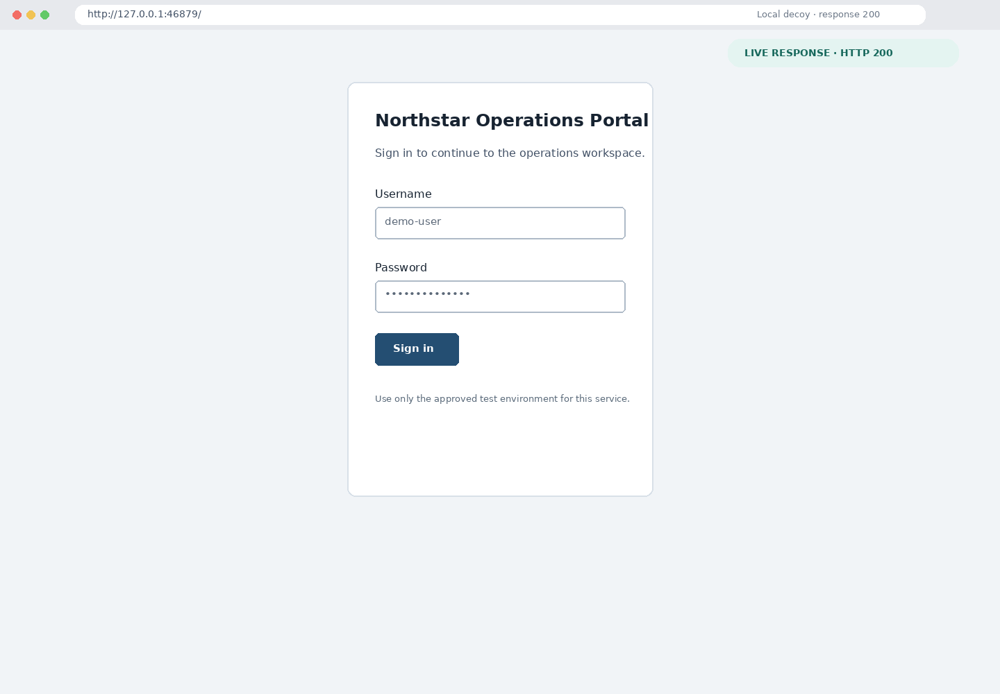
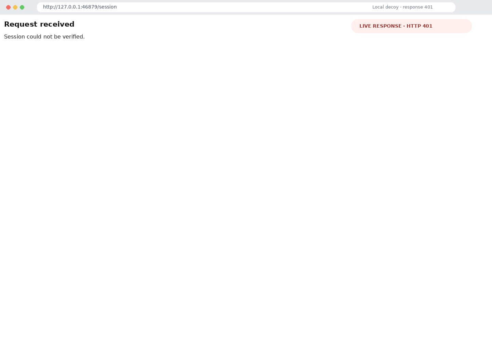
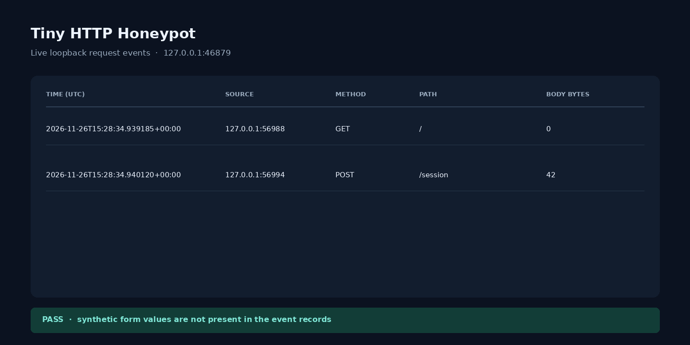

# Live demo

This walkthrough starts the honeypot on this computer only, sends a normal page request and a fake form submission, and checks the responses and event log. It does not contact an outside host.

## What the code does

`honeypot.py` uses Python's built-in HTTP server. A GET request receives the fictional Northstar Operations Portal page. A POST receives a generic 401 response. The handler never reads the submitted form body: it uses the `Content-Length` header to record only the number of bytes sent.

Each request writes a JSON event with the timestamp, source address and port, method, path, and body size. Query strings are removed from the logged path. The built-in HTTP request logger is disabled so it cannot accidentally add the full request target to the log.

`gui.py` is a local control panel for starting and stopping the same server. It displays the JSON events as readable lines. The default bind address is `127.0.0.1`, so the demo is reachable only from this computer.

## Run the automated live check

From the project folder, run:

```sh
bash scripts/live_demo.sh
```

The script starts the server on loopback port 18080, sends a GET and a POST with clearly fake values, checks for HTTP 200 and 401 respectively, then confirms those values do not appear in the event log. It stops the server and removes its temporary log when it finishes.

If port 18080 is already in use, choose another unused local port:

```sh
PORT=18081 bash scripts/live_demo.sh
```

Expected output:

```text
GET / -> HTTP 200
POST /session with synthetic values -> HTTP 401
PASS: request metadata was recorded; sample form values were not logged.
```

Run the unit tests separately:

```sh
python3 -m unittest -v
```

## Run the graphical demo

Open the control panel:

```sh
python3 gui.py
```

Leave the bind address as `127.0.0.1`. If port 8080 is unavailable, enter an unused port such as 18080. Select **Start local decoy**, then run these commands in another terminal:

```sh
curl --noproxy '*' -i http://127.0.0.1:18080/
curl --noproxy '*' -i -X POST --data 'username=demo-user&password=fake-test-only' http://127.0.0.1:18080/session
```

The first request returns the fictional page. The second returns 401. The GUI log shows the method, path, source, and body byte count; it does not show either sample value. Select **Stop** when finished.

## Live run evidence

A fresh local browser walkthrough returned **HTTP 200** for the portal and **HTTP 401** for the synthetic form submission. The server emitted one `GET /` event and one `POST /session` event. The log contains the body byte count but not the submitted values.

The images below are visual evidence cards rendered from the actual HTTP response bodies and server event lines produced by that loopback run. They are not raw desktop screenshots of the Tkinter control panel.

### Portal response — HTTP 200



### Generic session response — HTTP 401



### Request events



The form used only the clearly synthetic values `demo-user` and `fake-test-only`. Neither value appears in the event records.

## Limits

This is a low-interaction teaching demo, not a production security product. It uses plain HTTP, does not store events, does not establish that activity is malicious, and must not be exposed to the public internet. Use only synthetic form values and networks you own or are authorised to monitor.
